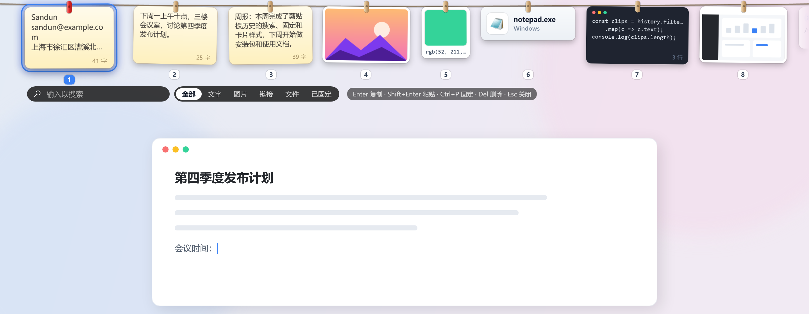
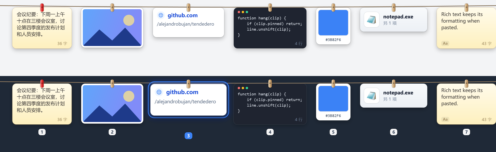
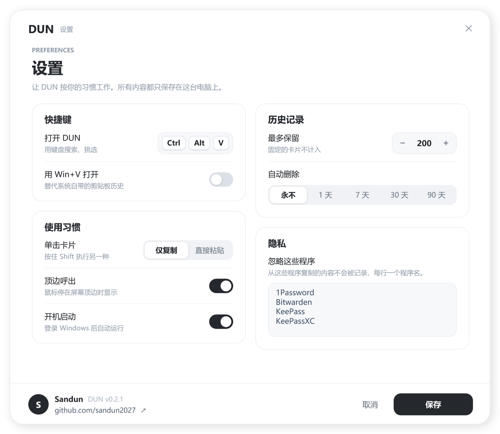

# DUN

> **致谢**：DUN 的灵感来自 [Tendedero](https://github.com/alejandrobujan/tendedero)，
> 这是 [Alejandro Buján](https://github.com/alejandrobujan) 做的一款 macOS 截图小工具：截过的图像照片一样挂在屏幕顶部的晾衣绳上。
> 这个点子太可爱了，可惜只有 Mac 版。DUN 把它搬到了 Windows，并扩展成了完整的剪贴板工具。
> 谢谢原作者的创意和开源精神。DUN 是独立编写的 Windows 实现，没有使用原项目的名称和图标。

**把剪贴板历史晾在一根绳上。**



在 Windows 上复制的东西，包括文字、链接、代码、颜色、图片、文件，都会变成一张卡片，挂在屏幕顶部的细绳上。
鼠标停在屏幕顶边就能看到；按快捷键可以用键盘搜索、选择、粘贴。

## 功能

- **一种内容一种卡片**：文字是便签，代码是深色代码卡，链接显示域名，颜色值直接变色卡，图片是相框，文件是文件卡。
- **不重复**：再次复制已有的内容，原来那张卡片回到最前面。
- **固定常用内容**：固定的卡片用红色夹子排在最左边，永远不会被自动清理。
- **键盘模式**：直接打字搜索，按分类筛选，Ctrl+1…9 直接取用。
- **可选接管 Win+V**：替代系统自带的剪贴板历史。
- **隐私**：不需要账号、不联网、不收集任何数据；默认忽略常见密码管理器；可以随时暂停记录。
  所有内容都只保存在本机 `%LOCALAPPDATA%\DUN`。



## 安装

在 [Releases](../../releases) 下载：

- `DUN-Setup-x.y.z.exe`：安装程序，不需要管理员权限；
- `DUN-x.y.z-portable.exe`：便携版，单个 exe，放哪儿都能运行。

要求 Windows 10 1809 及以上的 64 位系统，已经自带 .NET 运行时，不用另装。

<p align="center"></p>

> 程序还没有代码签名，第一次运行时 Windows 可能提示"已保护你的电脑"，点 **更多信息 → 仍要运行** 即可。

## 使用

| 鼠标 | |
|---|---|
| 停在屏幕顶边 | 在这块屏幕上显示晾衣绳 |
| 单击 | 复制（Shift+单击：粘贴到当前窗口） |
| 双击 | 打开：图片用看图软件，链接用浏览器，文字进编辑窗口 |
| 按住 | 编辑（图片用画图，文字用编辑窗口） |
| 中键 | 快速查看 |
| 右键 | 粘贴、粘贴为纯文本、固定、编辑、另存为、删除… |
| 拖出 | 拖一份副本到任意程序或文件夹 |
| 滚轮 | 沿着绳子左右滚动 |

| 键盘模式（默认 **Ctrl+Alt+V**，开启后也可用 Win+V） | |
|---|---|
| 直接打字 | 搜索 |
| ← → | 选择 |
| Enter / Shift+Enter | 复制 / 粘贴到原来的窗口 |
| Ctrl+1…9 | 直接使用对应的卡片 |
| Tab | 切换分类（全部、文字、图片、链接、文件、已固定） |
| Ctrl+P · Ctrl+E · 空格 · Del | 固定 · 编辑 · 快速查看 · 删除 |
| Esc | 关闭 |

托盘图标 → 设置：修改快捷键、开启 Win+V、把单击改为粘贴、最多保留条数和保留天数、要忽略的程序、开机启动。
托盘菜单还可以暂停记录、清空历史。

<p align="center"></p>

## 从源码构建

需要 .NET 8 SDK。

```powershell
dotnet run                                   # 直接运行
powershell -File scripts\build-release.ps1   # 在 dist\ 生成安装包、便携版和源码压缩包
```

打包还需要 [Inno Setup 6](https://jrsoftware.org/isinfo.php)（`winget install JRSoftware.InnoSetup`）。
图标由 `scripts\make-icon.ps1` 用代码绘制。README 里的截图由 `DUN.exe --shots docs` 生成：用示例数据离屏渲染，不会读取你的剪贴板历史；
安装程序的截图用 `DUN-Setup-x.y.z.exe --shot docs\setup-ready.png ready`（也可以是 `installing`、`done`）。

| 路径 | 内容 |
|---|---|
| `src/AppController.cs` | 启动、托盘菜单、设置 |
| `src/Watchers.cs` | 剪贴板监听、全局快捷键、Win+V 钩子 |
| `src/Clips.cs` | 剪贴项模型、类型识别、历史存储 |
| `src/LineWindow.cs` | 每块屏幕上的晾衣绳：布局、滚动、键盘模式 |
| `src/CardView.cs` | 单张卡片：样式、摆动、手势 |
| `src/Reveal.cs` | 什么时候显示、什么时候收起 |
| `src/Actions.cs` | 复制、粘贴、拖出、打开、编辑、右键菜单 |
| `src/Dialogs.cs`、`src/Ui.cs` | 设置、编辑窗口，以及它们共用的圆角卡片、开关、分段控件 |
| `src/Shots.cs` | 生成 README 截图 |
| `installer/` | 安装程序：`shell/` 是安装界面（WPF），`DUN.iss` 是内嵌的 Inno Setup 安装引擎 |

## 作者

[Sandun](https://github.com/sandun2027)

## 许可

[MIT](LICENSE) © 2026 Sandun
